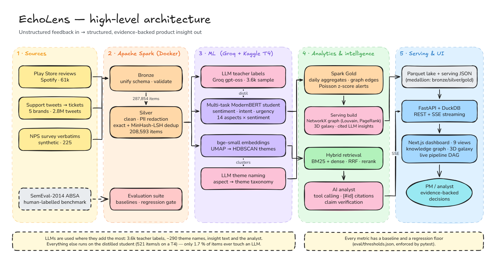

# EchoLens — Customer Feedback Intelligence

EchoLens turns unstructured customer feedback (app reviews, support tickets, NPS surveys) into **structured, evidence-backed product insight**:
aspect-level sentiment, intent and urgency for every item, a discovered two-level theme taxonomy, emerging-issue alerts, a knowledge graph, and an AI analyst whose every claim cites the feedback it is based on — and is checked against it.

> Built as a portfolio project for the Enterpret ML internship. Every model has a baseline and a regression threshold; see [docs/EVALUATION.md](docs/EVALUATION.md).

## Live demo

[Open EchoLens on GitHub Pages](https://simran-kalkeri.github.io/enterpret/).

The hosted dashboard uses the built-in sample data and a simulated AI analyst. GitHub Pages serves the static frontend; the Python API, live LLM calls, and ML pipeline run separately using the setup below.

Changes to `web/` on `main` automatically rebuild and publish through `.github/workflows/deploy-pages.yml`. To build the Pages export locally, run `GITHUB_PAGES=true npm run build` from `web/` with `NEXT_PUBLIC_API_URL` unset; the site is written to `web/out/`.

## Results at a glance

**Scale:** 2.81M raw tweets + 61.6k reviews + 225 surveys → **287,854** feedback items → **208,593** after cleaning, PII redaction and dedup → **291 themes** across 6 workspaces, **164 alerts**. The student model enriched the whole corpus at **521 items/s on a Kaggle T4**, and only **1.7 %** of items ever needed an LLM call.

| Model | Metric | EchoLens | Baseline |
|---|---|---|---|
| Sentiment (student) | macro-F1 | **0.817** | 0.696 TF-IDF+LR |
| Intent (6 classes) | macro-F1 | **0.624** | 0.582 |
| Urgency (4 classes) | macro-F1 | **0.497** | 0.439 |
| Aspect-sentiment (14 aspects × 3) | joint F1 | **0.558** | 0.471 |
| Same architecture on SemEval-2014 (human labels) | category F1 | **0.849** | — |
| Retrieval, hybrid + cross-encoder | Recall@10 / MRR | **0.493 / 0.335** | 0.467 / 0.326 dense only |
| Spike detector (simulated incidents) | recall / false alerts per theme-day | **0.667 / 0.1 %** | 0.633 / 0.1 % (2×-mean rule with look-ahead) |
| LLM-written insights (96 artifacts) | share of claims supported by cited feedback | **0.686** | — |

### It found real incidents, unsupervised

| Workspace | Theme the pipeline discovered and named | Peak | What actually happened |
|---|---|---|---|
| Spotify | *Login Failures*, *Unexpected Log-Outs* | 8 Mar 2022 (296/day vs 0.5 baseline) | Spotify's global outage |
| Spotify | *Controversial Content and Ad Concerns* | 27 Jan 2022 | Joe Rogan / Neil Young controversy |
| Apple | *Autocorrect Changing Letter "I" to Symbols* | 2–3 Nov 2017 | iOS 11.1 "A [?]" autocorrect bug |
| Apple | *iPhone Pre-Order Confirmation Problems* | 27 Oct 2017 | iPhone X pre-orders opened |
| Apple | *Random Restarts and Shutdowns* | 2 Dec 2017 | iOS 11.1.2 date-related restart bug |

### What did not go as hoped (reported as measured)

- **The distilled student is cheaper, not better, than a zero-shot LLM.** On the same 240-item subset, zero-shot `gpt-oss-20b`/`qwen3.8-27b` scores 0.72 intent / 0.53 urgency macro-F1 against the student's 0.58 / 0.49. Sentiment is roughly tied (0.83 vs 0.82). The student wins on cost and latency (an LLM call for 1.7 % of the corpus, 521 items/s), not on quality. More and cleaner teacher labels are the obvious next step.
- **Groundedness is 0.686, below the 0.80 target I set beforehand.** Most unsupported claims are summarising sentences with no citation, or numbers the judge could not match to the stats. The live-analyst question set (9 questions) was not completed because all three Groq free-tier models hit their daily token caps. A single spot check scored 0.80.
- **Silhouette favours KMeans** (0.43 vs HDBSCAN's 0.28 at the same k), which is expected for a metric that rewards convex clusters. HDBSCAN was kept for density-based noise handling (6.8 % noise after reassignment) and an NPMI coherence of 0.11.
- **Spike detection only catches large incidents.** Recall is 10 % for 1.5× incidents, 83 % at 2× and 100 % at 3×+.

Pre-registered targets that were missed are listed above. `eval/thresholds.json` holds **regression floors** pinned at this run, not quality claims. Full report: [docs/EVALUATION.md](docs/EVALUATION.md).

## Architecture

High-level, low-level and workflow diagrams (editable Excalidraw scenes with PNG/SVG exports) are in [architectures/](architectures/README.md).



```
 Sources ─► Spark: Bronze (unify + validate) ─► Spark: Silver (clean, PII redaction, exact + MinHash-LSH dedup)
                                                    │
                                     Groq LLM teacher labels a 3.6k stratified sample (gpt-oss-120b test set + 120b/20b train)
                                                    │
                          Kaggle GPU: distil into multi-task ModernBERT student ─► predict all 190k+ items
                                      bge-small embeddings ─► UMAP + HDBSCAN themes (per workspace)
                                                    │
                     LLM theme naming (c-TF-IDF + representative docs) ─► aspect → theme taxonomy
                                                    │
        Spark: Gold — daily aggregates · Poisson z-score anomaly detection · emerging themes · graph edges
                                                    │
     NetworkX (Louvain, PageRank) · hybrid retrieval (BM25 + dense, RRF, cross-encoder) · cited LLM insights
                                                    │
                        FastAPI over DuckDB ─► Next.js dashboard (9 views, incl. live pipeline DAG)
```

| Layer | Tech | Why |
|---|---|---|
| Batch processing | **Apache Spark 4** (PySpark, Docker), Parquet medallion lake | Join 2.8M tweets into conversations, LSH dedup, window-function analytics at scale |
| Labelling | **Groq** `gpt-oss-120b` (test set + train) and `gpt-oss-20b` (train) | LLM-as-teacher: high-quality labels on a small sample |
| Student model | **ModernBERT-base**, multi-task heads (sentiment, intent, urgency, 14×4 aspect-sentiment), trained on **Kaggle T4 GPU** | Runs over the whole corpus at a fraction of the LLM cost |
| Themes | bge-small-en-v1.5 → UMAP → HDBSCAN, LLM-named | Data-driven taxonomy like Enterpret's adaptive taxonomy |
| Trends | Poisson z-score vs 14-day trailing baseline (Spark windows) + emerging-theme detector | Interpretable, evaluated with injected incidents |
| Retrieval | BM25 + dense, reciprocal-rank fusion, ms-marco cross-encoder rerank | Measured against dense-only and BM25-only |
| AI analyst | Groq tool calling (5 tools), `[#id]` citations, LLM-judge claim verification; automatic model fallback when a free-tier daily cap is hit | Grounded, auditable answers |
| Serving | FastAPI + DuckDB + numpy vector index | No database server; deployable anywhere |
| Frontend | Next.js 15, Tailwind v4, shadcn/Radix, ECharts, Sigma.js, React Three Fiber, React Flow, GSAP | Knowledge graph, 3D embedding galaxy, pipeline DAG |

## Data

| Channel | Source | Items |
|---|---|---|
| Reviews | [Spotify Play Store reviews 2022](https://www.kaggle.com/datasets/mfaaris/spotify-app-reviews-2022) | 61k |
| Support tickets | [Customer Support on Twitter](https://www.kaggle.com/datasets/thoughtvector/customer-support-on-twitter): 2.8M tweets → conversation starters answered by AppleSupport, AmazonHelp, Uber_Support, Delta, XboxSupport | 226k |
| Surveys | **Synthetic** NPS verbatims generated with `qwen3.8-27b` (no public survey data exists for the same product) — flagged as `source=survey`, ids `sv_*` | 225 |
| Benchmark | [SemEval-2014 Task 4](https://www.kaggle.com/datasets/charitarth/semeval-2014-task-4-aspectbasedsentimentanalysis) restaurants (human labels) | 3k |

Each brand is a **workspace** (like a customer tenant in Enterpret).

## Dashboard

| View | What it shows |
|---|---|
| Overview | KPIs, sentiment trend, theme river, aspect sentiment, calendar heatmap, movers, cited insight cards |
| Pipeline | Live DAG of the run: engine, rows in → out, duration, data-quality checks per stage |
| Knowledge graph | Themes ↔ aspects ↔ intents ↔ channels, Louvain communities, PageRank sizing (Sigma.js / WebGL) |
| Galaxy | 3D UMAP of feedback embeddings coloured by theme or sentiment (React Three Fiber) |
| Themes | Aspect → theme taxonomy (treemap/sunburst), cited theme summaries, evidence |
| Alerts | Spikes vs expected band, LLM explanation with citations |
| Analyst | Streaming tool-using agent; claim-level support check and groundedness score |
| Explorer | Hybrid semantic search + filters over every item |
| Evaluation | All metrics vs baselines and thresholds |

## Run it

Requirements: Docker, Python 3.11, Node 22, a Groq API key, a Kaggle account (GPU).

```bash
uv venv --python 3.11 .venv && uv pip install --python .venv -r requirements-pipeline.txt
docker build -t echolens-spark -f infra/spark.Dockerfile infra
cp .env.example .env            # add GROQ_API_KEY
python -m pipeline.cli all      # ingest → label → kaggle → themes → gold → serving → eval
uvicorn api.main:app --port 8000
cd web && npm install && NEXT_PUBLIC_API_URL=http://localhost:8000 npm run dev
```

Or serve the prebuilt data: `docker compose up --build` → http://localhost:3000 (API docs at http://localhost:8000/docs).

**What the repository ships with:** the gold lake tables (`data/lake/gold`, `data/lake/themes`), per-workspace embedding shards for search (`data/index`, built by `python -m retrieval.build_index`), serving JSON, run logs, teacher labels, and the LLM response cache. With these, the API, dashboard and analyst work from a fresh clone without rerunning the pipeline. Raw datasets, bronze/silver tables, the 600 MB student checkpoint and the full Kaggle outputs are not included; `python -m pipeline.cli all` rebuilds them.
Without an API URL the frontend runs on built-in mock data.

Tests: `pytest` (unit tests, API contract tests, and the metric regression gate against `eval/thresholds.json`).

## Repository

```
pipeline/   spark_jobs/ (ingest: bronze+silver, gold, trends), build_serving.py, cli.py, common/runlog.py
ml/         labeling/ (Groq teacher, synthetic surveys), kaggle/ (GPU job + orchestration), themes/ (naming, NPMI)
retrieval/  hybrid search          analyst/  LLM client, tool-using agent, claim verifier
api/        FastAPI + DuckDB       web/      Next.js dashboard
eval/       evaluation suite, synthetic-incident injection, thresholds
docs/       api-contract.ts (shared types), EVALUATION.md
architectures/  Excalidraw diagrams (high-level, low-level, workflow) + PNG/SVG exports
```

## Design decisions & trade-offs

- **Distillation instead of calling an LLM per item.** The LLM labels ~3.6k items; a ModernBERT-base student labels the rest. The test set is labelled only by the strongest model (gpt-oss-120b), and the student is compared with a TF-IDF baseline and a zero-shot LLM. The zero-shot baseline is never allowed to fall back to the teacher model.
- **Two-level taxonomy.** Fixed L1 aspects (supervised, stable across workspaces for comparison) plus discovered L2 themes (unsupervised, specific to each product).
- **Poisson z-scores over ML anomaly detectors.** Daily counts per theme are small and sparse; a count model with a trailing baseline is explainable to a PM and is tested with injected incidents with known start dates.
- **Grounding is measured, not assumed.** Citations to ids the tools never returned are removed, and every remaining claim is checked by an LLM judge against the cited text.
- **DuckDB + Parquet for serving** instead of Postgres/pgvector: ~200k rows fit in memory, so serving needs no database server.
- **Limitations.** Teacher labels are not human gold, so student metrics measure agreement with the teacher; the SemEval benchmark gives a human-labelled check. Surveys are synthetic. Ticket workspaces cover Oct–Dec 2017; reviews cover Jan–Jul 2022. Groq free-tier daily caps (200k tokens/model/day) shaped several choices: 2 teachers in parallel, cached LLM responses, a reduced zero-shot subset.
