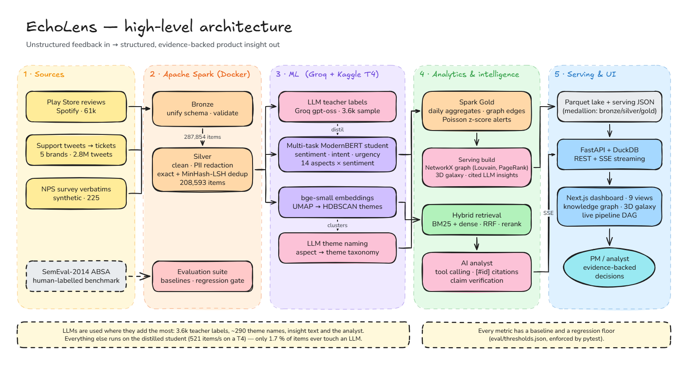

# EchoLens architecture diagrams

Every diagram is a native **Excalidraw** scene (`*.excalidraw`). You can open and edit any of them at [excalidraw.com](https://excalidraw.com) (File → Open) or with the VS Code *Excalidraw* extension. Boxes and arrows are bound together, so arrows follow a box when you drag it. Rendered previews are in [`exports/`](exports/).

| # | Diagram | Level | What it shows |
|---|---|---|---|
| 01 | [High-level architecture](exports/01-high-level-architecture.png) · [.excalidraw](01-high-level-architecture.excalidraw) | High | Sources → Spark → ML → analytics & intelligence → serving & UI |
| 02 | [Spark data pipeline](exports/02-low-level-spark-data-pipeline.png) · [.excalidraw](02-low-level-spark-data-pipeline.excalidraw) | Low | Bronze ingestion & validation rules; silver cleaning, PII redaction, exact + MinHash-LSH dedup |
| 03 | [ML: distillation & themes](exports/03-low-level-ml-distillation-and-themes.png) · [.excalidraw](03-low-level-ml-distillation-and-themes.excalidraw) | Low | Groq teacher labelling, ModernBERT multi-task student on Kaggle, UMAP + HDBSCAN themes, LLM naming |
| 04 | [Trend & emerging-issue detection](exports/04-low-level-trend-and-emerging-issue-detection.png) · [.excalidraw](04-low-level-trend-and-emerging-issue-detection.excalidraw) | Low | Poisson z-score spike detector, emerging-theme rule, severity, synthetic incident-injection eval |
| 05 | [Retrieval & AI analyst](exports/05-low-level-retrieval-and-ai-analyst.png) · [.excalidraw](05-low-level-retrieval-and-ai-analyst.excalidraw) | Low | BM25 + dense + RRF + cross-encoder; tool-calling agent, citation normalisation, claim verification |
| 06 | [Serving, API & frontend](exports/06-low-level-serving-api-and-frontend.png) · [.excalidraw](06-low-level-serving-api-and-frontend.excalidraw) | Low | DuckDB/FastAPI endpoints, Next.js views & libraries, docker-compose deployment |
| 07 | [Workflow orchestration](exports/07-workflow-orchestration.png) · [.excalidraw](07-workflow-orchestration.excalidraw) | Workflow | `pipeline.cli all` steps, where each runs, its outputs, the Kaggle round trip, quality gates |



## Regenerating

The scenes are generated from code, so they stay in sync with the pipeline:

```bash
python architectures/_build/diagrams.py          # writes the *.excalidraw files
python architectures/_build/render_server.py     # then open http://localhost:8765/_build/render.html
```

The render page uses the official [`@excalidraw/excalidraw`](https://github.com/excalidraw/excalidraw) exporter (`exportToSvg` / `exportToBlob`) and writes SVG and 2× PNG files to `exports/`.
